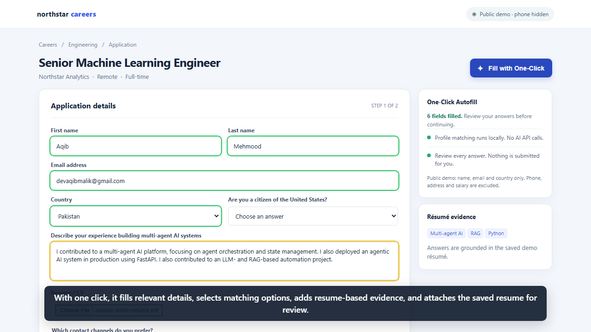

# One-Click Job Autofill

Chrome extension that scans job-application fields and fills them from your saved profile and résumé. Matching and answers run locally in the browser; there are no third-party AI providers, API keys, or cloud answer requests. The extension never submits an application or checks consent/attestation boxes.

## Setup

1. Optionally start the local résumé text extractor (Windows) when you want to parse a new résumé:
   ```powershell
   cd backend
   py -m venv .venv
   .\.venv\Scripts\Activate.ps1
   pip install -r requirements.txt
   uvicorn main:app --host 127.0.0.1 --port 8000
   ```
   It only listens on your computer. `/health` should report `mode: local-only`.
2. In Chrome, open `chrome://extensions`, enable Developer mode, choose **Load unpacked**, and select the `extension` folder.
3. Open **Profile and settings**, select your original résumé file (up to 10 MB), optionally extract its details, review the profile, and save.
4. Open a job application, click the extension, and review every highlighted value before submitting yourself.

## Local matching and privacy

- Direct fields (such as name, email, phone, and user-entered work authorization) use your saved profile.
- The settings profile starts with neutral, blank personal details. Add only the profile information you want to use, and review it before saving. Citizenship and other sensitive details are never assumed.
- Résumé extraction also captures education, employment dates and durations, job titles, employers, locations, descriptions, skills, certifications, and LinkedIn/GitHub/website links when those details are present in selectable PDF/DOCX/text content.
- Unmatched questions are compared locally against résumé sentences and saved answers. A match is shown in yellow for review. If the résumé does not contain evidence, the field is left for you.
- Evidence-backed technical questions can receive a concise résumé-based response using documented project experience. The extension does not claim unlisted framework experience or assume which vector database was used; ambiguous yes/no questions are left unanswered.
- Salary amounts are configured in your local profile under `salary_expectation`, by currency and monthly amount. Annual questions are calculated as 12 monthly payments; questions without a stated period are treated as annual. Currency explicitly stated in a question takes precedence; otherwise, a currency choice uses your desired work country when available.
- Unanswered fields stay on the application for your review. The extension does not add an unanswered-question panel or keep an accumulated question count.
- Personal/legal answers are never guessed. Checkbox consent, certification, or attestation is never selected automatically.
- PDF/DOCX/ODT/HTML/TXT/MD text extraction is performed by the local Python service. Résumé text and profile data are stored in Chrome local storage and are not sent to an AI service.
- When you manually change a form answer, the extension saves the question and answer in the profile's local `answers` object. Next time it can reuse an exact question or a close match. Consent and attestation answers are not learned. Review or delete learned answers in **Profile and settings**.
- The original résumé file is stored locally and can be attached to a résumé/CV upload field without running the parser. The original file can be any format, though a job site's own file-type or size rules still apply. Text extraction supports PDF, DOCX, ODT, HTML, TXT and MD. Autofill and the stored file remain available after closing the terminal or restarting the computer, as long as Chrome and the extension are installed with the same browser profile.
- Scanned/image-only PDFs are not OCR'd and need to be converted to a text-based résumé first.

The local matcher uses explicit phrase and evidence matching plus a small set of résumé-grounded technical response templates, not a generative language model. It leaves unsupported questions unanswered rather than inventing facts.

## Demo video

[](media/demo.mp4)

The 54-second demo shows the project owner's name, public email address and country (Pakistan), as requested. It deliberately hides the phone number, street address, salary, real résumé file and sensitive demographic/work-authorization answers. Technical résumé examples and the job application are synthetic demo content. The MP4 includes English narration and on-screen captions; [download the narration audio separately](media/demo-narration.mp3).

## Tests

Install the test dependencies and run:
```powershell
pip install pytest playwright
playwright install chromium
pytest tests
```

## Synthetic demo

The `media` folder contains a browser demo page, a public-profile-only video, its preview image, and a separate narration audio track. The demo never contains the owner's phone number or actual résumé.
